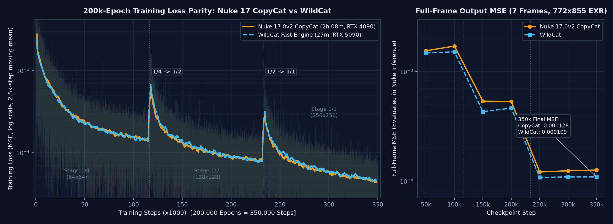

# WildCat

**简体中文** | **[English](README_EN.md)**

[](LICENSE)
[](#安装与启动)
[](#核心特性)
[](https://www.python.org/)
[](https://pytorch.org/)

WildCat 是一个面向影视视效（VFX）序列帧的神经网络训练、批量消融实验与推理工作台，原生支持 **Windows** 与 **Linux** 部署，提供 **中英双语（简体中文 / English）** 网页端操作界面。

训练流程严格对齐 Nuke **CopyCat** 并保持 100% 推理兼容：

- **默认 100% 原生一致**：不开启可选高级旋钮时，训练参数、单位、采样网格、三尺度金字塔损失与学习率曲线同 Nuke 17 CopyCat 完全一致；
- **同卡整次训练提速约 1.8×～5.3×**：通过数据显存常驻、整步 CUDA Graph 捕获、融合 Adam、NHWC 内存布局与副卡异步预览，在不改变训练结果的前提下缩短耗时（见「同卡速度」一节）；
- **无缝接入 Nuke 管线**：全流程采用 ACEScg 线性空间与 16-bit Half OpenEXR（网页预览经 OCIO 实时转换 sRGB）；导出的 TorchScript（`.pt`）模型经 Nuke 自带的 **CatFileCreator** 节点转换为 `.cat` 后，可直接接入 **Inference** 节点；
- **可选的增强策略**：6 个高级参数模块和 6 个任务场景预设（另有一键恢复 Nuke 默认），默认全部关闭，关闭时训练与 CopyCat 相同。每一项的测试方法与结果在网页帮助中心的「策略依据（进阶）」页（2026-11 重新验证：每个配置 3 个随机种子，只在模型没有训练过的帧上评分，与相位对齐的 CopyCat 默认设置成对比较）；`data/open_experiments.db` 收录这些测试的全部原始记录（935 次训练，见「实验记录数据库」一节），以及早期 206 组单种子对比实验的存档；
- **面部编辑**：第四种模型架构 **WildCatLargeV1**（单遍四尺度一阶齐次 U-Net + PixelShuffle + 1×1 通道混合 + 原图恒等残差跳跃，5.08M 参数，导出的 `.pt` 同样经 CatFileCreator 接入 Nuke Inference）、「关键帧共性」模块（手绘关键帧彼此不一致时，训练前把个别关键帧中与其他关键帧不一致的局部改成一致；DIS 光流）、「面部编辑」预设（WildCatLargeV1 + 1 px 裁剪网格 + Charbonnier 0.25 + 关键帧共性 + 平均权重）与任务页的「训练质量（中间帧）」监控；
- **说明就在参数旁**：网页里每个参数和指标旁都有「?」，悬停看简介，点击打开帮助中心的完整说明。

---

## 核心特性

1. **中英双语界面 & Windows / Linux 原生双平台**
   - 顶栏支持 **简体中文 / English** 一键无刷新切换（零硬编码语言包架构，放入 `frontend/locales/<lang>.json` 自动发现）；
   - 同时提供 `wildcat.sh`（Linux）与 `wildcat.bat`（Windows 10/11/Server）一键启停、增量热更新与安全回滚。
2. **六个任务场景预设 + 可选高级参数**
   - 内置 **擦除修补、绿幕抠像、失焦还原、去噪 / 去颗粒、Roto 遮罩、面部编辑** 六套配参，一键填入模型规模、通道与相关开关（依据 2026-11 的重新验证；预设不改动 Epochs）；
   - 6 个可选的高级参数模块：裁剪网格（1 px，含网格锚点）、复合损失（Charbonnier / 梯度项 / 高光衰减）、阶段比例与切换过渡、平均权重（EMA）、数据增广（水平翻转 / 曝光扰动）、关键帧共性；每一项在帮助中心有原理说明与测试依据，全部关闭时与 CopyCat 默认行为一致。
3. **四种模型架构：CopyCat 默认三档与 WildCatLargeV1**
   - **CopyCat 默认做法（Small / Medium / Large）**：同一套 `[32, 64, 128]` 编解码器（`ReLU` 残差块 + `4×4` 转置卷积上采样）在 `1/4`、`1/2`、`1/1` 串行前向 3 遍，级间双线性放大拼接并直接输出全部目标通道像素，按卷积核尺寸与残差块层数分为 `Small`（1.03M）、`Medium`（2.58M）、`Large`（6.88M），通用于抠像、去噪、Roto、失焦还原与擦除修补；
   - **WildCatLargeV1 做法（5.08M，「面部编辑」预设默认）**：采用单遍 4 尺度非对称 U-Net（`1/1 → 1/2 → 1/4 → 1/8`，通道 `64 → 96 → 128 → 160`），浅层使用 `64` 通道配 `3×3` 窄核合成局部细节、深层使用 `5×5` 提取大范围姿态，解码采用 `PixelShuffle(2)` 上采样与 `1×1` 逐像素通道混合层（`64 → 192 → 64`），全程使用无归一化一阶齐次 `LeakyReLU(0.05)`，并在同通道任务上预测局部增量叠加回输入原图。网页帮助中心提供两套结构的对比矢量图与同卡 3 种子测试数据。
4. **实验对比工作台（Experiments Lab）与多卡池管理**
   - 支持一键构建「参数组合探索队列」批量排队训练，支持多任务曲线同屏叠加、整条序列流式帧间差异（一阶 `ΔR` / 二阶 `HFI` / 静止区变化）测量与同步放大检视器，以及 CSV 报表导出；
   - 管理后台支持动态检测任意张数物理显卡，独立开关各卡参与调度并指定 **主卡（优先训练）** 与 **副卡（并行接单 + 零抢占异步预览/验证）**，配合 `data/gpu_benchmarks.db` 实测速度库精准预估排队与剩余时间。

---

## 实验记录数据库（`data/open_experiments.db`）

随库的 SQLite 数据库收录两批实验，全部是原始记录：

- **2026-11 起的实验**（`exp2026_*` 表，共 935 次训练）：重新验证 394 次（7 个通用数据集；每个配置 3 个随机种子，只在模型没有训练过的帧上评分，与相位对齐的 CopyCat 默认设置成对比较）、
  逐条补测 24 次、预设复核 3 次、面部编辑预设加不加 Charbonnier 的成对测试 133 次（5 个公开面部镜头 × 4 种关键帧情况 × 3 个种子 × 加 / 不加，另有同一任务换平台的重跑）、v3 网络架构（WildCatLargeV1 对照 Small / Medium / Large 与各候选结构）同卡 3 种子测试 183 次，以及关键帧共性研究 198 次。
  帮助中心「策略依据（进阶）」页的数字都来自这些记录。表的说明在 `exp2026_about` 里；每次训练的设置、所用显卡与 torch 版本、速度、各评估点的分数（原始权重 / 平均权重，未见帧 / 训练帧）和最后一步的逐帧分数都在。
  没有收录：内部制作素材、用非商用授权的换脸模型做出的镜头、用户提供的素材；机器名、路径与代码哈希也不写入。
- **早期对比实验**（`experiment_runs` 等表，347 条记录，即「实验」页的种子数据）：206 组单种子实验的存档。使用其中的数字前请注意它的局限：

- 每个配置只跑了一个随机种子；同一配置重复运行，留出帧分数可相差约 0.5 dB；
- 每个数据集的留出帧只有 2 帧，并且同时用于挑选配置，不是独立的测试集；
- 9 个数据集中 6 个是合成数据；
- 其中 3 个数据集的底板高度不是 4 的倍数，默认配置的基线分数存在评测口径问题，相关对比已从本页撤下。

下表只保留能从原始记录复算、且不受上述口径问题影响的两项（留出帧 PSNR，训练结束时的数值），仍属单种子结果：

| 数据集 | 默认配置 | 开启选项后 | 差值 | 开启的选项 |
| --- | --- | --- | --- | --- |
| SmartVector 擦跟踪点（合成数据：实拍底板上贴图，960×540） | 54.09 dB | 59.02 dB | +4.93 dB | `Small`，只开 `1px` 裁剪网格 |
| 绿幕抠像去溢色（真值由公式生成，960×540，3→4 通道） | 61.45 dB | 64.40 dB | +2.95 dB | `Small`，`1px` + 复合损失（0.30 / 0.15 / 0.35） |

2026-11 的重新验证已经完成（每个配置 3 个随机种子、每个数据集 24–83 张未见帧、与相位对齐的 CopyCat 默认设置成对比较）：各项策略的结论与数字见网页帮助中心的「策略依据（进阶）」页，任务预设按重新验证的结果设置。

---

## 与 CopyCat 的对应关系

| CopyCat 控件 | WildCat | 说明 |
| --- | --- | --- |
| Epochs（默认 10000） | Epochs | Total Steps = ceil(Epochs × 数据集帧数 / Batch Size) |
| Batch Size：Auto / Manual | Auto (8) / 手动 | Auto = 8，显存不足时自动减半；上限不超过训练帧数 |
| Crop Size（默认 256） | Crop Size | 32 / 64 / 128 / 256 / 384 / 512 |
| Model Size：Small / Medium / Large | Small / Medium / Large + **WildCatLargeV1** | Small (1.03M) / Medium (2.58M) / Large (6.88M) / WildCatLargeV1 (5.08M) |
| Use Multi-Resolution Training | Multi-Resolution | 默认开启：1/4 → 1/2 → 1/1 三段等长 |
| Initial Weights：None / Checkpoint | 同 | 从已有 `.pt` 检查点续训时自动锁定模型规格与通道 |
| Checkpoint Interval（默认 1000 步） | Checkpoint Interval | 定期保存 `Training_YYMMDD_HHMMSS.<step>.pt`（TorchScript） |
| Contact Sheet Interval（默认 100 步） | Contact Sheet Interval | 定期保存 `Training_YYMMDD_HHMMSS.<step>.png` 及 3×3 局部预览 |
| Automatic Mixed Precision | Mixed Precision | 默认 Adaptive（独立沙盒测速自动选 FP16/FP32） |
| Learning Rate（1e-4） / Seed（0） | Learning Rate / Seed | 默认 `poly(0.3)` 缓降学习率 |

任务目录 `run/<任务名>/`：

```text
run/<任务名>/
├── Training_261110_041929.1000.pt      # 每个 Checkpoint Interval 一个 TorchScript 模型（支持单版本或打包下载）
├── Training_261110_041929.100.png      # Nuke 标准拼图
├── Training_261110_041929.summary      # step,loss,step,loss,...
├── ckpt/step_001000.pt  latest.pt      # 断点续训检查点（含优化器状态）
├── contact_sup/step_000100.png         # 3×3 局部块实时预览（crop 1..3 × input|groundtruth|output）
├── preview_sup/<帧名>/step_000100.png  # 整帧预览（Web 端播放器使用）
└── train.log                           # 实时训练日志与完整异常堆栈
```

---

## 在 Nuke 中使用

1. 在 Nuke 中创建 **CatFileCreator** 节点；
2. `Torch Script File` 选择 WildCat 导出的 `.pt`（网页下载的模型或 `run/<任务名>/Training_*.<step>.pt`）；
3. `Channels In` / `Channels Out` 按训练通道填写（如 `rgba.red, rgba.green, rgba.blue`；4 通道抠像输出填 `rgba.red, rgba.green, rgba.blue, rgba.alpha`；单通道遮罩输出填 `rgba.alpha`）；
4. 设置 `Cat File` 输出路径，点击 **Create .cat file**；
5. 在 **Inference** 节点的 `Model File` 中加载生成的 `.cat`。

> **PyTorch 版本提示**：Nuke 17 内置的 libtorch 无法读取 PyTorch ≥ 2.12 导出的 TorchScript 归档，请安装 `torch>=2.8.0,<2.12`（推荐 `torch==2.11.0+cu128`）。

---

## 同卡速度与 20 万轮精度一致性

同一台工作站、同一张 GPU 上对比 Nuke 17.0v2 CopyCat 与 WildCat（默认无损加速，40 帧 772×855 半精度 EXR，开启 Multi-Resolution，Mixed Precision = Adaptive；表中为 `1/4 · 1/2 · 1/1` 三阶段稳定段 steps/s）：

| GPU | 模型 | Batch | Crop | CopyCat | WildCat | 整个训练提速 |
| --- | --- | --- | --- | --- | --- | --- |
| RTX 4090 | Small | 4 | 256 | 68.8 · 66.4 · 55.2 | 511 · 344.7 · 164.5 | **4.4×** |
| RTX 4090 | Small | 8 | 256 | 68.6 · 64 · 41.6 | 421.3 · 242.8 · 94.5 | **3.2×** |
| RTX 4090 | Medium | 4 | 256 | 64.5 · 61.6 · 44.3 | 375.8 · 232.6 · 98.7 | **3.2×** |
| RTX 4090 | Medium | 8 | 256 | 64.4 · 51.8 · 30.9 | 304.2 · 155 · 55.5 | **2.4×** |
| RTX 4090 | Medium | 8 | 512 | 48.1 · 17.1 · 8.7 | 155 · 55.3 · 14.1 | **2.0×** |
| RTX 4090 | Large | 4 | 256 | 30 · 27.6 · 19.4 | 156.7 · 97.9 · 40.9 | **3.0×** |
| RTX 4090 | Large | 8 | 256 | 30.4 · 20.4 · 13 | 128.3 · 64.5 · 23 | **2.4×** |
| RTX 5090 | Small | 4 | 256 | 67.3 · 63.6 · 55.1 | 585.8 · 409.3 · 198.3 | **5.3×** |
| RTX 5090 | Small | 8 | 256 | 64.8 · 61.9 · 42.6 | 507.1 · 299.7 · 119 | **4.0×** |
| RTX 5090 | Medium | 4 | 256 | 64.5 · 63.5 · 43.5 | 410.5 · 274.7 · 124.8 | **3.8×** |
| RTX 5090 | Medium | 8 | 256 | 60.6 · 55.6 · 36 | 291.6 · 162.4 · 71.8 | **2.6×** |
| RTX 5090 | Medium | 8 | 512 | 54.4 · 35.7 · 13.1 | 183.7 · 71.9 · 20 | **1.8×** |
| RTX 5090 | Large | 4 | 256 | 27.8 · 27.1 · 20.2 | 174.2 · 116.4 · 52.1 | **3.7×** |
| RTX 5090 | Large | 8 | 256 | 29.5 · 23.3 · 15.2 | 141.4 · 76.7 · 29.5 | **2.6×** |

- 低分辨率阶段提速最多（3~9 倍）：CopyCat 每步有固定的调度开销，WildCat 把整步做成一张 CUDA Graph 后几乎没有这部分开销；
- 全分辨率阶段两边都接近显卡算力上限，提速约 1.5~3.6 倍；Batch 越大、模型越大、Crop 越大，差距越小。

在相同默认参数下运行 200,000 Epochs（350,000 步），三阶段训练 Loss 收敛曲线与 Nuke 17.0v2 CopyCat 全程重合（35 万步最终整帧 MSE：CopyCat `0.000126`，WildCat `0.000109`）：



### 显存自适应（16 / 24 / 32 GB）

- **Auto Batch**：默认 8，启动前实测一步峰值显存，超出则自动减半；
- **智能常驻 / 锁页预取**：阶段数据集不超过空闲显存 60% 时常驻显存（16 GB 卡约可常驻 85 帧 4K / 320 帧 2K 半精度 EXR），超出后自动切换后台锁页内存预取，速度损耗仅 0～4%；
- **大画幅分块推理**：整帧推理显存不足时自动切换 1024 分块（128 px 重叠无缝融合）。

---

## 安装与启动

支持 **Windows**（Windows 10 / 11 / Server 2022）与 **Linux**（Ubuntu 22.04+ / Rocky Linux 9），NVIDIA 驱动 ≥ 570，Python 3.12。

### Windows（CMD / PowerShell）

```bat
git clone https://github.com/vfxli/WildCat_public.git WildCat && cd WildCat
py -3.12 -m venv .venv
.venv\Scripts\activate
pip install torch==2.11.0 torchvision --index-url https://download.pytorch.org/whl/cu128
pip install -r requirements.txt
wildcat.bat start
```

### Linux

```bash
git clone https://github.com/vfxli/WildCat_public.git WildCat && cd WildCat
python3.12 -m venv .venv && source .venv/bin/activate
pip install torch==2.11.0 torchvision --index-url https://download.pytorch.org/whl/cu128
pip install -r requirements.txt
./wildcat.sh start
```

启动后用浏览器访问 `http://127.0.0.1:8765`（局域网访问 `http://<主机IP>:8765`）。首次启动若未设置环境变量 `WC_PASSWORD`，会自动生成随机管理员密码并打印在 `wildcat.log` 中；也可随时运行 `set_admin_password.bat` 或 `bash set_admin_password.sh` 重置密码。

### 服务管理与命令行

```bash
# Linux 服务启停与热更新
./wildcat.sh start | stop | restart | status | update | rollback

# Windows 服务启停与热更新
wildcat.bat start | stop | restart | status | update | rollback

# CLI 独立调用
python train.py config/default.json                 # 训练
python infer.py config/default.json dataset/eval    # 序列推理（输出 16-bit half EXR）
python export_cat.py config/default.json            # 导出 TorchScript 模型 (.pt)
```

---

Nuke 与 CopyCat 为 Foundry 的产品。

## License

[MIT](LICENSE)
