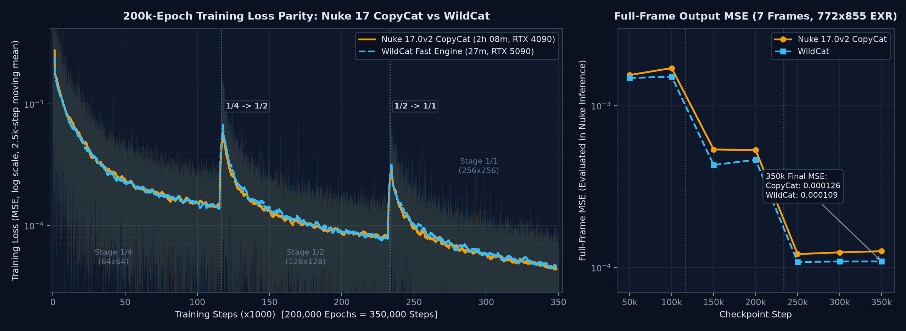

# WildCat

**简体中文** | **[English](README_EN.md)**

[](LICENSE)
[](#安装与启动)
[](#核心特性)
[](https://www.python.org/)
[](https://pytorch.org/)

WildCat 是一个面向影视视效（VFX）序列帧的神经网络训练、批量消融实验与推理工作台，原生支持 **Windows** 与 **Linux** 部署，提供 **中英双语（简体中文 / English）** 网页端操作界面。

训练流程严格对齐 Nuke **CopyCat** 并保持 100% 推理兼容：

- **默认 100% 原生一致**：不开启可选高级旋钮时，训练参数、单位、采样网格、三尺度金字塔损失与学习率曲线同 Nuke 17 CopyCat 完全一致；
- **同卡提速 2.1×～5.5×**：通过数据显存常驻、整步 CUDA Graph 捕获、融合 Adam、NHWC 内存布局与副卡零抢占异步预览，在不改变训练结果的前提下大幅缩短耗时；
- **无缝接入 Nuke 管线**：全流程采用 ACEScg 线性空间与 16-bit Half OpenEXR（网页预览经 OCIO 实时转换 sRGB）；导出的 TorchScript（`.pt`）模型经 Nuke 自带的 **CatFileCreator** 节点转换为 `.cat` 后，可直接接入 **Inference** 节点；
- **内置亿级 Epoch 实测指南与场景预设**：随库附带 **16 卡主力 RTX 5090 集群累计训练 1.53 亿原生 Epoch（7.50 亿多路影子权重演化轮次）、覆盖 9 类真实影视镜头的 206 组全盲测实验数据库**（`data/open_experiments.db`），沉淀为五大高频视效任务一键预设与智能验证集检查点推荐器。

---

## 核心特性

1. **中英双语界面 & Windows / Linux 原生双平台**
   - 顶栏支持 **简体中文 / English** 一键无刷新切换（零硬编码语言包架构，放入 `frontend/locales/<lang>.json` 自动发现）；
   - 同时提供 `wildcat.sh`（Linux）与 `wildcat.bat`（Windows 10/11/Server）一键启停、增量热更新与安全回滚。
2. **五大视效场景实测一键预设 + 可选高级超参实验室**
   - 内置 **带噪实拍修擦、绿幕抠像去溢色、虚焦散景/动模恢复、暗部去噪/干净擦点、人物肢体 Roto** 五套盲测最优配参，一键填入模型规模、轮次、裁剪窗口与全部开关；
   - 提供 5 项经全量盲测验证的高级策略旋钮（`1px` 逐像素全相位裁剪采样、Charbonnier + L1 空间梯度 + ACEScg 亮度阻尼复合损失、散景专属 `15/25/60` 阶段加权、换挡自动重置 `Stage-Reset EMA 0.9995`、成对水平镜像翻转），每项均附带物理原理与 LaTeX 公式推导。
3. **智能验证集检查点推荐与自动延训**
   - 数据集附带整条原片验证序列时，系统自动在 `1/1` 全分阶段结合无监督时序抗闪烁指数（`HFI`）、训练帧记忆饱和门控与遮罩防塌陷检测，自动评选 **「⚖️ 综合均衡最优」「🎬 连播低闪烁最优」「🎯 局部贴回细节最优」** 三个最佳检查点（146 组轨迹回测选点遗憾下降 **46.3%**）；到达目标轮数仍未见拐点时可自动平滑延训。
4. **实验对比工作台（Experiments Lab）与多卡池管理**
   - 支持一键构建「最佳参数组合探索队列」批量排队训练，支持多任务曲线同屏叠加、整条序列流式无监督帧间抖动（一阶 `ΔR` / 二阶 `HFI` / 静止区沸腾）测量与同步放大检视器，以及 CSV 报表导出；
   - 管理后台支持动态检测任意张数物理显卡，独立开关各卡参与调度并指定 **主卡（优先训练）** 与 **副卡（并行接单 + 零抢占异步预览/验证）**，配合 `data/gpu_benchmarks.db` 实测速度库精准预估排队与剩余时间。

---

## 9 类视效镜头盲测核心结论速览

在 206 组严格留出帧（Unseen Hold-out）盲测与百帧连播闪烁测试中：

| 镜头类型 | Nuke 默认盲测 PSNR | WildCat 推荐方案 PSNR | 净提升 / 关键收益 | 推荐核心配置 |
| --- | --- | --- | --- | --- |
| 干净底板擦点（SmartVector） | 54.09 dB | **59.02 dB** | **+4.93 dB**（消除 4px 相位盲区） | `Small · 1px 切图` |
| 绿幕抠像去溢色（3→4 RGBA） | 61.45 dB | **64.40 dB** | **+2.95 dB**（发丝锐利 · Alpha 零阻尼） | `Small · 1px + Grad 0.15 + HDR 0.35` |
| 大光圈散景追焦恢复 | 33.83 dB | **43.55 dB** | **+9.72 dB**（唯一必上 Large 场景） | `Large · 15/25/60 阶段 + HDR 0.50` |
| 多帧快速运动模糊恢复 | 43.25 dB | **47.13 dB** | **+3.88 dB**（宽感受野包裹模糊轨迹） | `Large · 1px + Grad 0.10 + Stage-EMA` |
| 实拍人脸伤疤擦除（带颗粒） | 30.49 dB | **30.83 / 30.79 dB** | **百帧连播闪烁降 -25.9% · 背景干净 4.1×** | `Small + HFlip 0.5` 或 `Medium 组合` |
| 2K 高清局部修脸 | 38.25 dB | **39.59 dB** | **+1.34 dB**（2K 画幅放宽视野至 384） | `Small/Med · Crop 384 + 抗噪复合损失` |
| 暗部高感传感器去噪 | 41.32 dB | **41.78 dB** | **+0.46 dB**（约 70% 步数锁峰值防背噪点） | `Small · 1px + C0.25/G0.05/H0.50` |
| 街舞 / 跑酷人物肢体 Roto | 15.61 dB | **16.30～17.30 dB** | **纯黑底漏灰压低 10.2×**（补齐极值姿态） | `Small · 3→1ch · HDR=0 + Stage-EMA` |

> **三条关键反直觉发现**：
> 1. **模型并非越大越好**：除「虚焦散景 / 大跨度运动模糊」需要 `Large` 宽感受野外，在绿幕抠像（`Large` 反跌 `-2.71 dB`）、Roto 遮罩（反跌 `-3.97 dB`）和带噪去噪/修擦上，**`Small (1.03M)` 凭借天然低容量正则化全面胜出且快 4～5 倍**；
> 2. **裁剪框切勿贴近画幅短边**：HD 画面盲目拉满 `Crop 512` 会令平移采样多样性坍缩，抠像与散景反跌 `-2.5～-2.8 dB`（常规首选 `256`，2K 局部修补可选 `384`）；
> 3. **选帧重位置而非堆时长**：局部修擦仅画镜头正中 1 张代表帧（`30.98 dB`）胜过只画首尾 2 张帧 `+1.27 dB`；总关键帧 `≤6` 张时切勿拆出内部验证帧，建议全部投入训练并挂载整条原片序列选优。

---

## 与 CopyCat 的对应关系

| CopyCat 控件 | WildCat | 说明 |
| --- | --- | --- |
| Epochs（默认 10000） | Epochs | Total Steps = ceil(Epochs × 数据集帧数 / Batch Size) |
| Batch Size：Auto / Manual | Auto (8) / 手动 | Auto = 8，显存不足时自动减半；上限不超过训练帧数 |
| Crop Size（默认 256） | Crop Size | 32 / 64 / 128 / 256 / 384 / 512 |
| Model Size：Small / Medium / Large | 同 | Small (1.03M) / Medium (2.58M) / Large (6.88M) |
| Use Multi-Resolution Training | Multi-Resolution | 默认开启：1/4 → 1/2 → 1/1 三段等长 |
| Initial Weights：None / Checkpoint | 同 | 从已有 `.pt` 检查点续训时自动锁定模型规格与通道 |
| Checkpoint Interval（默认 1000 步） | Checkpoint Interval | 定期保存 `Training_YYMMDD_HHMMSS.<step>.pt`（TorchScript） |
| Contact Sheet Interval（默认 100 步） | Contact Sheet Interval | 定期保存 `Training_YYMMDD_HHMMSS.<step>.png` 及 3×3 局部预览 |
| Automatic Mixed Precision | Mixed Precision | 默认 Adaptive（独立沙盒测速自动选 FP16/FP32） |
| Learning Rate（1e-4） / Seed（0） | Learning Rate / Seed | 默认 `poly(0.3)` 缓降学习率 |

任务目录 `run/<任务名>/`：

```text
run/<任务名>/
├── Training_261110_041929.1000.pt      # 每个 Checkpoint Interval 一个 TorchScript 模型（支持单版本或打包下载）
├── Training_261110_041929.100.png      # Nuke 标准拼图
├── Training_261110_041929.summary      # step,loss,step,loss,...
├── ckpt/step_001000.pt  latest.pt      # 断点续训检查点（含优化器与 Stage-EMA 状态）
├── contact_sup/step_000100.png         # 3×3 局部块实时预览（crop 1..3 × input|groundtruth|output）
├── preview_sup/<帧名>/step_000100.png  # 整帧预览（Web 端播放器使用）
└── train.log                           # 实时训练日志与完整异常堆栈
```

---

## 在 Nuke 中使用

1. 在 Nuke 中创建 **CatFileCreator** 节点；
2. `Torch Script File` 选择 WildCat 导出的 `.pt`（网页推荐的最优检查点或 `run/<任务名>/Training_*.<step>.pt`）；
3. `Channels In` / `Channels Out` 按训练通道填写（如 `rgba.red, rgba.green, rgba.blue`；4 通道抠像输出填 `rgba.red, rgba.green, rgba.blue, rgba.alpha`；单通道遮罩输出填 `rgba.alpha`）；
4. 设置 `Cat File` 输出路径，点击 **Create .cat file**；
5. 在 **Inference** 节点的 `Model File` 中加载生成的 `.cat`。

> **PyTorch 版本提示**：Nuke 17 内置的 libtorch 无法读取 PyTorch ≥ 2.12 导出的 TorchScript 归档，请安装 `torch>=2.8.0,<2.12`（推荐 `torch==2.11.0+cu128`）。

---

## 同卡速度与 20 万轮精度一致性

同一台工作站、同一张 GPU 上对比 Nuke 17.0v2 CopyCat 与 WildCat（默认无损加速，40 帧 772×855 半精度 EXR，开启 Multi-Resolution，Mixed Precision = Adaptive；表中为 `1/4 · 1/2 · 1/1` 三阶段稳定段 steps/s）：

| GPU | 模型 | Batch | Crop | CopyCat | WildCat | 全程提速 |
| --- | --- | --- | --- | --- | --- | --- |
| RTX 4090 | Small | 4 | 256 | 68.8 · 66.4 · 55.2 | 511 · 344.7 · 164.5 | **4.4×** |
| RTX 4090 | Small | 8 | 256 | 68.6 · 64 · 41.6 | 421.3 · 242.8 · 94.5 | **3.2×** |
| RTX 4090 | Medium | 4 | 256 | 64.5 · 61.6 · 44.3 | 375.8 · 232.6 · 98.7 | **3.2×** |
| RTX 4090 | Medium | 8 | 256 | 64.4 · 51.8 · 30.9 | 304.2 · 155 · 55.5 | **2.4×** |
| RTX 5090 | Small | 4 | 256 | 67.3 · 63.6 · 55.1 | 585.8 · 409.3 · 198.3 | **5.3×** |
| RTX 5090 | Small | 8 | 256 | 64.8 · 61.9 · 42.6 | 507.1 · 299.7 · 119 | **4.0×** |
| RTX 5090 | Medium | 4 | 256 | 64.5 · 63.5 · 43.5 | 410.5 · 274.7 · 124.8 | **3.8×** |
| RTX 5090 | Medium | 8 | 256 | 60.6 · 55.6 · 36 | 291.6 · 162.4 · 71.8 | **2.6×** |
| RTX 5090 | Large | 4 | 256 | 27.8 · 27.1 · 20.2 | 174.2 · 116.4 · 52.1 | **3.7×** |

在相同默认参数下运行 200,000 Epochs（350,000 步），三阶段训练 Loss 收敛曲线与 Nuke 17.0v2 CopyCat 全程重合（35 万步最终整帧 MSE：CopyCat `0.000126`，WildCat `0.000109`）：



### 显存自适应（16 / 24 / 32 GB）

- **Auto Batch**：默认 8，启动前实测一步峰值显存，超出则自动减半；
- **智能常驻 / 锁页预取**：阶段数据集不超过空闲显存 60% 时常驻显存（16 GB 卡约可常驻 85 帧 4K / 320 帧 2K 半精度 EXR），超出后自动切换后台锁页内存预取，速度损耗仅 0～4%；
- **大画幅分块推理**：整帧推理显存不足时自动切换 1024 分块（128 px 重叠无缝融合）。

---

## 安装与启动

支持 **Windows**（Windows 10 / 11 / Server 2022）与 **Linux**（Ubuntu 22.04+ / Rocky Linux 9），NVIDIA 驱动 ≥ 570，Python 3.12。

### Windows（CMD / PowerShell）

```bat
git clone https://github.com/vfxli/WildCat_public.git WildCat && cd WildCat
py -3.12 -m venv .venv
.venv\Scripts\activate
pip install torch==2.11.0 torchvision --index-url https://download.pytorch.org/whl/cu128
pip install -r requirements.txt
wildcat.bat start
```

### Linux

```bash
git clone https://github.com/vfxli/WildCat_public.git WildCat && cd WildCat
python3.12 -m venv .venv && source .venv/bin/activate
pip install torch==2.11.0 torchvision --index-url https://download.pytorch.org/whl/cu128
pip install -r requirements.txt
./wildcat.sh start
```

启动后用浏览器访问 `http://127.0.0.1:8765`（局域网访问 `http://<主机IP>:8765`）。首次启动若未设置环境变量 `WC_PASSWORD`，会自动生成随机管理员密码并打印在 `wildcat.log` 中；也可随时运行 `set_admin_password.bat` 或 `bash set_admin_password.sh` 重置密码。

### 服务管理与命令行

```bash
# Linux 服务启停与热更新
./wildcat.sh start | stop | restart | status | update | rollback

# Windows 服务启停与热更新
wildcat.bat start | stop | restart | status | update | rollback

# CLI 独立调用
python train.py config/default.json                 # 训练
python infer.py config/default.json dataset/eval    # 序列推理（输出 16-bit half EXR）
python export_cat.py config/default.json            # 导出 TorchScript 模型 (.pt)
```

---

Nuke 与 CopyCat 为 Foundry 的产品。

## License

[MIT](LICENSE)
